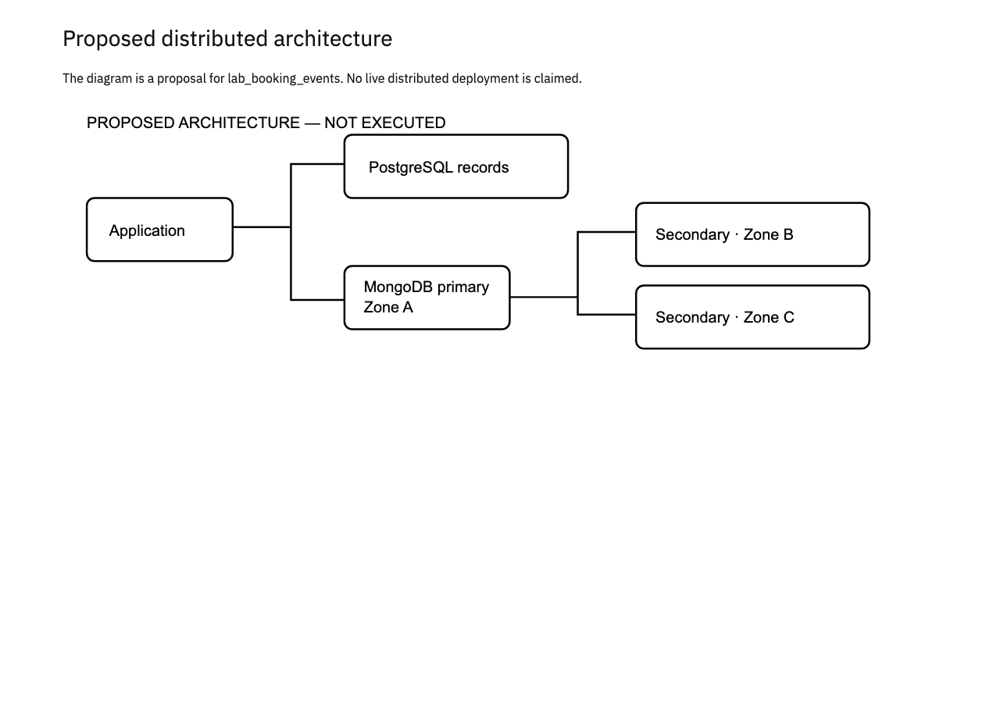

# MIT 8103 laboratory equipment booking exercise: Portfolio 5

This is the proposed distributed design for the case study.

## Case and proposed deployment

The case keeps its relational records in PostgreSQL. The proposed deployment retains the `lab_booking_events` document model implemented in Portfolio 4. Each document has `_id`, `schemaVersion`, `simulation`, `eventType`, `occurredAt`, `source`, `embedded`, `references`, and `details`. The two synthetic documents use `source.key.return_id` to identify a saved return record. They demonstrate document structure, not a chronological request and approval history.

MongoDB's `_id` index rejects duplicate event identifiers. The implemented `event_type_time` index covers `eventType` and `occurredAt`; it does not enforce booking versions. Portfolio 4 implements no `booking_version` field or unique booking-version index. A future application would need a separate ordering and idempotency design before using these documents as a booking event log.

The proposed application connects to a three-member MongoDB replica set across three availability zones in one region. PostgreSQL needs its own availability configuration. A MongoDB replica set does not replicate PostgreSQL. The diagram below illustrates this proposal, not an executed deployment.

## Replication and availability

One primary accepts writes. Two secondaries copy the operation log asynchronously. If the primary fails, eligible members can elect a replacement when a voting majority is available. Writes can pause during election. A partition without a majority cannot elect a primary. Three containers on one computer would not protect against loss of that computer.

## Consistency and the case

For `lab_booking_events`, a proposed client policy is majority write concern with a finite timeout, primary reads and majority read concern where committed data is required. Secondary reads can lag. A future writer would reuse a stable `_id` for each logical event when retrying a write. The sample script demonstrates duplicate-ID rejection, but does not implement application retries. PostgreSQL still enforces valid booking dates and one active booking per unit. These settings do not create an atomic transaction across PostgreSQL and MongoDB. An outbox and retrying consumer would be a separate implementation.

## Sharding trade-off

Sharding partitions documents; replication copies them for availability. The small sample in this portfolio does not need sharding. If `lab_booking_events` becomes large, evaluate a high-cardinality source-record identifier as a possible hashed shard key against actual query and write patterns. A time-only increasing key can concentrate new writes, while a hashed key can make time-range queries contact multiple shards. Validate distribution and query plans before choosing a key.

## Cloud deployment and recovery

A real deployment would use private networking, authentication, least-privilege roles, TLS, monitoring and tested backups. Replication also copies accidental deletions, so it does not replace backups. Availability zones do not provide regional disaster recovery. No cloud service was provisioned and no failover, replication, sharding or recovery experiment was run for this discussion.

## References

- [MongoDB: replication](https://www.mongodb.com/docs/manual/replication/)
- [MongoDB: sharding](https://www.mongodb.com/docs/manual/sharding/)

